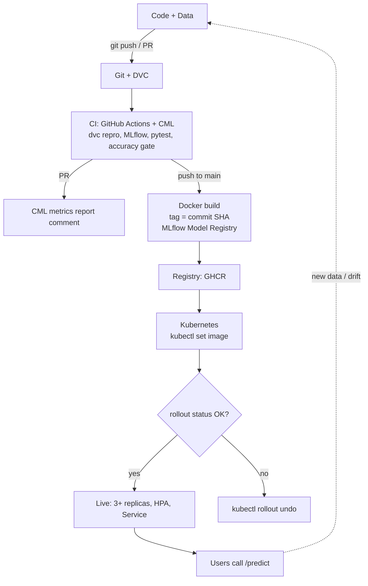

# Question 2: Deploying a Model as a Scalable Service with CI/CD

An Iris classifier served with FastAPI, packaged with Docker, tracked with MLflow and DVC, deployed on Kubernetes, and automated with GitHub Actions + CML.

## Project structure

```
iris-k8s-mlops/
├── src/prepare.py          # load Iris, split into train/test
├── src/train.py            # train model, log to MLflow, save model + metrics
├── app/main.py             # FastAPI: /predict and /health
├── tests/test_api.py       # API tests (run in CI)
├── params.yaml             # hyperparameters
├── dvc.yaml                # DVC pipeline (prepare -> train)
├── Dockerfile              # container for the API
├── k8s/deployment.yaml     # 3 replicas + liveness/readiness probes
├── k8s/service.yaml        # NodePort service (port 30080)
├── k8s/hpa.yaml            # autoscaler (3 to 10 pods at 50% CPU)
└── .github/workflows/ci-cd.yml   # CI (CML) -> build/push -> deploy
```

## What you need

- Python 3.11, Git, a GitHub account
- Docker Desktop
- minikube (or kind) and kubectl

---

## Part (a): Model API and Dockerfile

**1. Train the model**

```bash
python -m venv venv
venv\Scripts\activate            # Windows   (Linux/Mac: source venv/bin/activate)
pip install -r requirements.txt

git init
dvc init
dvc repro                        # runs prepare.py then train.py
```

Output: `model/model.pkl` and `metrics.json` (about 93% accuracy).

**2. Run the API locally**

```bash
uvicorn app.main:app --reload
```

Open http://localhost:8000/docs, or call it:

```bash
curl http://localhost:8000/health
curl -X POST http://localhost:8000/predict -H "Content-Type: application/json" -d "{\"sepal_length\":6.7,\"sepal_width\":3.0,\"petal_length\":5.2,\"petal_width\":2.3}"
```

Expected: `{"prediction":2,"class_name":"virginica","confidence":1.0,...}`

**3. Build and run the Docker image**

```bash
docker build -t iris-api:v1 .
docker run -p 8000:8000 iris-api:v1
```

Dockerfile points: slim base image, only serving libraries (`requirements-api.txt`), a non-root user, and `MODEL_VERSION` passed as a build argument.

---

## Part (b): Deploy on Kubernetes and scale

**1. Start minikube and load the image**

```bash
minikube start
minikube addons enable metrics-server      # needed for HPA
minikube image load iris-api:v1
```

For a local test, set the image in `k8s/deployment.yaml` to `iris-api:v1` and `imagePullPolicy: IfNotPresent`. Change it back to the GHCR image before part (d).

**2. Deploy**

```bash
kubectl apply -f k8s/deployment.yaml
kubectl apply -f k8s/service.yaml
kubectl get pods                           # 3 pods, all READY 1/1
kubectl describe pod <pod-name>            # see the probes
minikube service iris-api-svc --url        # get the URL, then call /health
```

- **Readiness probe**: Traffic goes to a pod only when `/health` returns 200.
- **Liveness probe**: Kubernetes restarts the container if `/health` keeps failing.

**3. Scale**

Manual:
```bash
kubectl scale deployment iris-api --replicas=5
kubectl get pods
```

Automatic (HPA):
```bash
kubectl apply -f k8s/hpa.yaml
kubectl get hpa
```

Load test to see it scale (in a second terminal):
```bash
kubectl run load --rm -it --image=busybox -- /bin/sh -c "while true; do wget -q -O- http://iris-api-svc/health; done"
kubectl get hpa -w                         # replicas go up when CPU > 50%
```

---

## Part (c): Build and publish with MLflow + Docker in CI/CD

**MLflow (in `src/train.py`)**
- Logs parameters (`n_estimators`, `max_depth`) and metrics (`accuracy`, `f1_macro`)
- Logs the model and registers it as **IrisModel** in the MLflow Model Registry (each run creates a new version)
- See the runs with: `mlflow ui --backend-store-uri sqlite:///mlflow.db`, then open http://localhost:5000

**CI/CD (`.github/workflows/ci-cd.yml`)**
- **Job `ci`**: installs packages, runs `dvc repro -f` (trains + logs to MLflow), runs `pytest`, checks accuracy ≥ 0.90, and uploads the model.
- **Job `build`**: builds the Docker image and pushes it to **GitHub Container Registry (GHCR)** with two tags:
  - `ghcr.io/<user>/<repo>:<commit-SHA>`, the exact version (used for deploys and rollback)
  - `ghcr.io/<user>/<repo>:latest`

GHCR uses the built-in `GITHUB_TOKEN`, so you don't need extra secrets.

**Push the project to GitHub**

```bash
git add .
git commit -m "Initial ML service"
git branch -M main
git remote add origin https://github.com/<user>/iris-k8s-mlops.git
git push -u origin main
```

After the first push: GitHub → your profile → **Packages** → `iris-k8s-mlops` → **Package settings** → set visibility to **Public**. This lets minikube pull the image without a password.

---

## Part (d): Continuous deployment with rollback

GitHub's cloud machines can't reach minikube on your laptop. So the `deploy` job runs on a **self-hosted runner** on your laptop.

**1. Set up the runner**

GitHub repo → **Settings → Actions → Runners → New self-hosted runner**. Follow the commands shown for your OS, then start it with `./run.sh` (or `run.cmd` on Windows). On Windows, install Git Bash, because the deploy steps use `shell: bash`.

**2. Point the deployment at GHCR**

In `k8s/deployment.yaml`, set:
```yaml
image: ghcr.io/<your-username>/iris-k8s-mlops:latest
imagePullPolicy: Always
```
```bash
kubectl apply -f k8s/deployment.yaml
```

**3. What the `deploy` job does on every push to main**

```bash
kubectl set image deployment/iris-api iris-api=ghcr.io/<user>/<repo>:<SHA>   # update
kubectl rollout status deployment/iris-api --timeout=120s                   # verify
kubectl rollout undo deployment/iris-api                                    # rollback (only if it fails)
```

It then checks `/health` through `kubectl port-forward`. If that fails, it rolls back too.

**Manual rollback commands**

```bash
kubectl rollout history deployment/iris-api
kubectl rollout undo deployment/iris-api                 # previous version
kubectl rollout undo deployment/iris-api --to-revision=2 # a specific version
```

**Test a rollback**: Set the image to a tag that doesn't exist, for example `kubectl set image deployment/iris-api iris-api=ghcr.io/<user>/<repo>:bad`. Then `rollout status` times out and `rollout undo` brings back the old version. Because of `maxUnavailable: 0`, the old pods keep serving the whole time.

**CML report on pull requests**

```bash
git checkout -b exp-depth
# change max_depth: 5 -> 2 in params.yaml
dvc repro
git add . && git commit -m "Try max_depth 2" && git push -u origin exp-depth
```

Open a pull request. CML posts a comment with the metrics, plus `dvc metrics diff` and `dvc params diff` against main:

| Path | Metric | main | PR | Change |
|---|---|---|---|---|
| metrics.json | accuracy | 0.9333 | 0.9 | -0.0333 |

> Commit `dvc.lock` and `metrics.json` to main so the diff has something to compare against.

---

## Part (e): Complete pipeline flow

```
 ┌──────────────┐
 │ Code + Data  │  app/, src/, params.yaml, dataset
 └──────┬───────┘
        │ git push / pull request
        ▼
 ┌──────────────┐
 │  Git + DVC   │  Git = code versions, DVC = data/model versions (dvc.yaml, dvc.lock)
 └──────┬───────┘
        ▼
 ┌─────────────────────────────┐
 │  CI  (GitHub Actions + CML) │  dvc repro → MLflow logs params/metrics/model
 │                             │  pytest → accuracy gate → CML report on PR
 └──────┬──────────────────────┘
        │ only if all checks pass
        ▼
 ┌─────────────────────────────┐
 │  Docker + MLflow            │  model registered in MLflow Registry
 │                             │  docker build (tag = commit SHA)
 └──────┬──────────────────────┘
        ▼
 ┌─────────────────────────────┐
 │  Registry (GHCR)            │  ghcr.io/<user>/<repo>:<SHA>  and  :latest
 └──────┬──────────────────────┘
        │ self-hosted runner
        ▼
 ┌─────────────────────────────┐
 │  Kubernetes                 │  kubectl set image → rollout status
 │  Deployment (3 replicas,    │  fail? → rollout undo
 │  probes) + Service + HPA    │
 └──────┬──────────────────────┘
        ▼
     Users → Service (load balancer) → /predict
        │
        └──► monitoring / new data → back to "Code + Data" (retrain)
```

Mermaid version (renders on GitHub):


